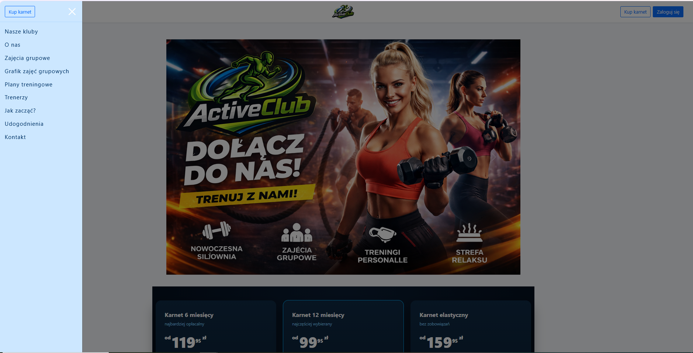
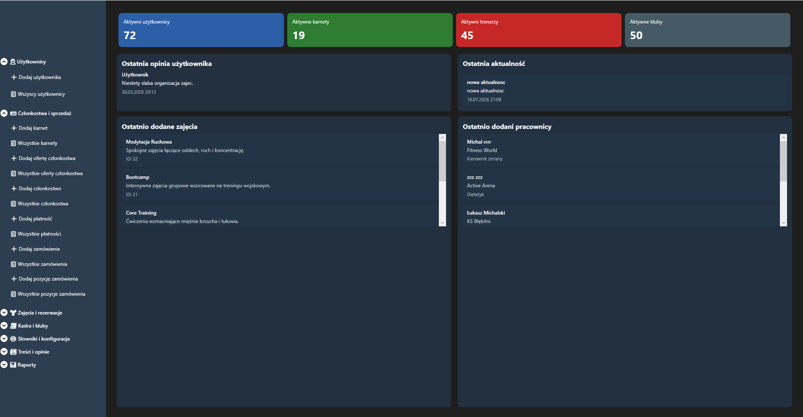
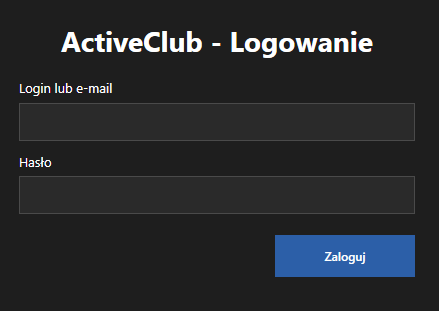
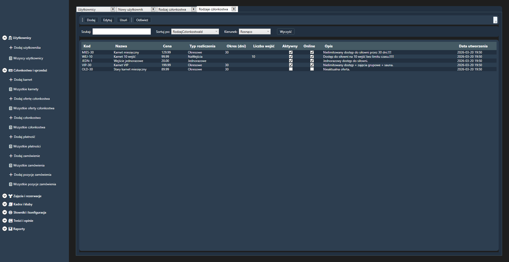
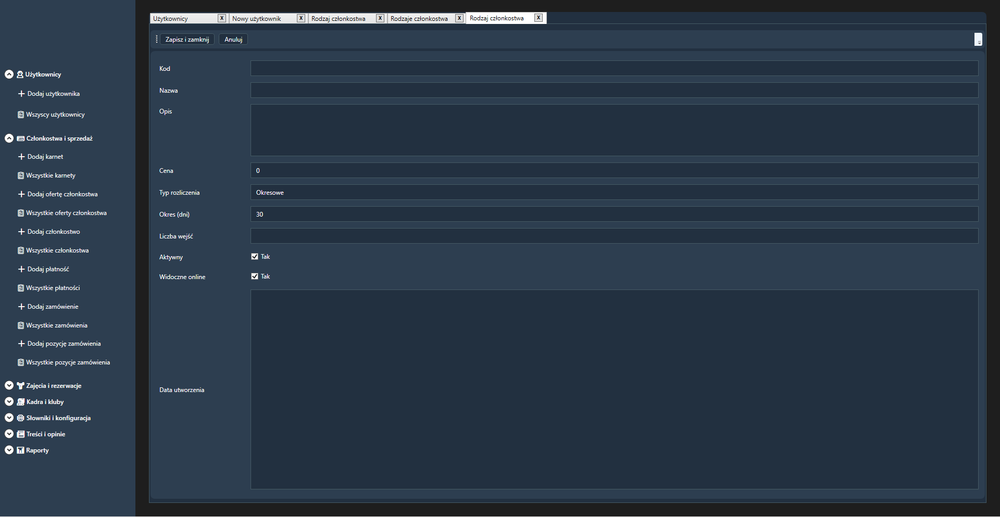

# ActiveClub

ActiveClub is a fitness club management system I built for my engineering degree. It includes an ASP.NET Core MVC web portal for members, a WPF desktop application for staff, and a shared REST API. Members can browse class schedules and book classes. Staff can manage schedules, bookings, and memberships.

## Screenshots

### Web portal

### Desktop application

#### Staff login

#### Membership types

#### Add a membership type

